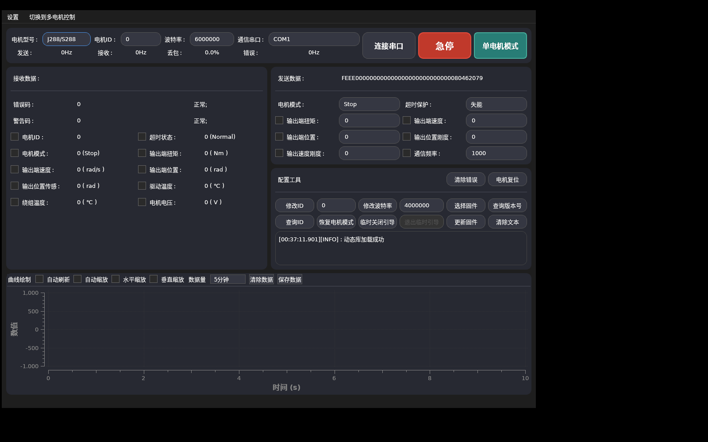
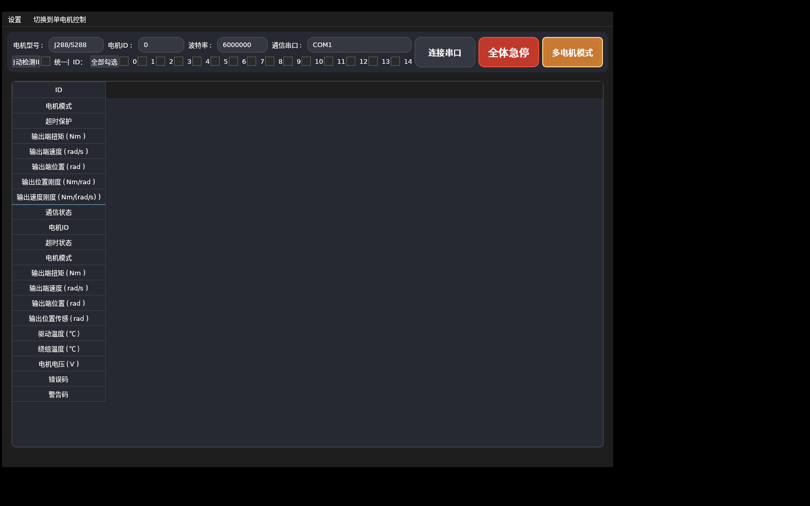
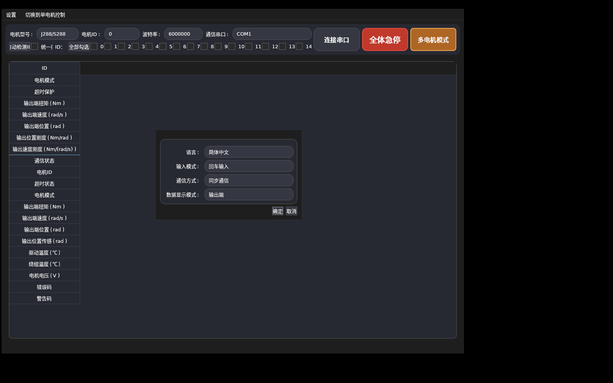

# 原安装包实现分析

分析对象：上游提交 `37ea172c9a8cbba854bd4af7573d328dbd9e5176`。日期：2026-11-14。

## 实际做了什么

1. 检查 PE 节区、导入表、Qt 元对象字符串、UTF-8 界面文字及 UTF-16 虚拟文件目录。
2. 识别 `.enigma1` / `.enigma2`：EXE 通过 Enigma Virtual Box 嵌入资源。
3. 用 `mos9527/evbunpack`（提交 `ee7b647acf2a46617b0c448dfa83d63132ea917b`）解包，得到原主程序、`UnitreeMotorSDK.dll`、QSS、两份翻译、图标和位置标定示意图。解包文件仅用于分析，未放入 Mac 应用。
4. 在隔离 Wine prefix / 虚拟显示上启动解包后的原程序，实际查看单电机、多电机和设置窗口，保存本目录截图。未连接实物。
5. 检查 SDK 导出接口与部分函数反汇编，确认参数签名；使用 Windows Python `ctypes` 离线调用 SDK，提取真实发送帧，并作为 Swift 测试的固定对照。

| 对象 | SHA-256 |
|---|---|
| 原仓库 `Unitree Motor Assistant.exe` | `8b6162227334f7a088bde9df80505116303706b905266df34e34aa0e65e3aaec` |
| 解出的 `UnitreeMotorSDK.dll` | `8330abd072b79b0b83e795894e4ff5b4558289be36319b6d69aaa0fa2dd06488` |

## 原版结构

原界面为 Qt Widgets，曲线使用 Qwt。Qt SerialPort 负责端口枚举，实际电机协议和设备控制由动态加载的 `UnitreeMotorSDK.dll` 提供；SDK 内含 libserialport 风格串口实现。界面通过 setter / getter 访问协议参数，支持同步 / 异步数据线程。

因此仅替换 Qt DLL 或修改构建文件无法移植：应用源码缺失，嵌入的 SDK 也只有 Windows PE 版本。当前重建 SwiftUI 界面、公开运动协议及从 SDK 还原的私有配置流程。

### 实拍：单电机



### 实拍：多电机



### 实拍：设置



## 功能对应表

| 原版能力 / 实现证据 | Swift 原生版状态 |
|---|---|
| J288/S288、IM6014 型号选择 | 按用户范围，仅 J288/S288 |
| 端口选择、6 Mbps 默认、4 Mbps 等列表 | Mac callout 端口、4 / 6 Mbps 主机设置 |
| 控制模式、超时、扭矩、速度、位置、Kp、Kd | 已实现，控制期间保持保护；启动前新增 Stop/零参数清锁存及重新开启保护确认 |
| 发送 / 接收 / 丢包 / 错误统计 | 累计帧数、超时比例、CRC 错误 |
| 温度、电压、编码器、错误、警告、原始报文 | 已解析；主要值显示于工作台，其余在模型 / 记录页 |
| ID 0–14 勾选、多电机轮询、统一控制 | 轮询与统一参数；广播停止；实机广播启动因缺少逐台确认而拒绝（演示只发送保留） |
| `Search_ID_Safe`、`Change_ID_Safe`、`Reset_ID` | 广播原始 ID 扫描 / 串口恢复重试；全总线 SN 修复与顺序重排 |
| `Change_Motor_BaudRate` | 设备配置、保存、主机切换与反馈确认 |
| `Clear_Error`、`RestartMotor` | 已实现并检查反馈 |
| `Ask_Version`、`Ask_SN` | 版本、SN 查询及旧固件 SN 读取回退 |
| `Change_ATB`、临时引导、`Swmotor` | 保存 ATB、有限次数临时保持 Boot；引导切换补齐 Stop / reset / 80 ms / command 5 |
| `OTA_App_Safe`、bin 固件进度 | APP 校验、擦除、分包/回读、CRC、保存和启动版本确认 |
| `OutPosRotorCal`、高精度上电位置 / 单圈行程 | 出厂、高精度、限位 A 与行程配置及回读 |
| 输出端 / 转子端参数 | 两种单位控制与反馈切换，位置/速度/扭矩/增益换算 |
| 同步 / 异步通信 | 同步请求应答；异步拆分发送与非阻塞接收，一个在途请求 |
| 实时输入 / 回车输入 | 逐字实时输入或回车 / 应用 |
| Qwt 曲线选择、刷新 / 缩放、30 秒至 1 小时数据 | 多项勾选（目标/反馈等 16 项）、刷新暂停、横纵缩放、历史/游标，30 秒至 1 小时记录与 CSV |
| CSV 导出 | 已实现，含单位、ID、时间、故障和演示标志 |
| 原版「急停」 / 全体急停 | 先广播停止，再验证已知 ID；广播自身不算确认 |

## SDK 对照方法

探针 `probe-sdk.py` 使用以下离线接口：

```text
NewUnitreeMotor(serialName, motorType, id, baudrate)
Set_Control_Data_Out(object, id, modeName, timeout, torque, speed, position, kp, kd)
PackTxAndGetMainData(object, buffer, capacity)
DeleteUnitreeMotor(object)
```

电机类型内部名称 `N1215-288`，模式 `Stop` / `Foc`。探针从未调用 `Connect`、`Serial_send` 或刷写接口。重新运行时使用 Windows Python，传入 `--dll` 和 `--output` 路径，并自行提供从相同版本安装包解出的 DLL。固定样本与随机种子 288 的样本合计 69 组。

真实 SDK 与公开 Python 的整数量化不同，详见 `../../PROTOCOL.md`。本次已验证传输编码，不等于完整反编译恢复源码，也不等于实物验证。

## 私有功能进一步分析

使用 Ghidra 和反汇编定位 SDK 私有状态机，串口层通过进程内钩子替换为模拟器，实际执行 `Change_ID_Safe`、`Change_ATB`、`OTA_App_Safe`、`OutPosRotorCal` 等函数。记录 133 条私有操作及 35 条重复 ID 修复的发送与合成应答，其中两种长度的完整 OTA、三种标定均返回成功。可复现探针为 `probe-private-sdk.py`；它实际调用写配置函数，但串口始终被替换，无物理 I/O。

Swift 自行实现报文和串口逻辑，不携带 Windows DLL；33 项测试覆盖正常与失败路径。详细布局、函数地址、校验和仍需硬件验证的事项见 [私有协议记录](../../PRIVATE-PROTOCOL.md)。

## 本次范围补齐的证据

`probe-parity-sdk.py` 记录 Search_ID_Safe、Swmotor 的发送顺序，以及输出/转子端和 ID 15 的控制编码。`probe-bus-sdk.py`、`probe-reorder-sdk.py` 使用 3 台合成设备（旧 ID 0、3、3），实际运行原 SDK Reset_ID 的模式 1 / 2，分别得到 0、3、1 和 0、1、2。

`ParityTests` 按顺序消费完整 SDK 记录，不能通过在任意位置寻找相同报文绕过步骤遗漏；原生额外执行保存后 ID 回读。合成回包仍不构成硬件验收。扫描原始 ID 返回不带 CRC，不能单凭它证明总线没有冲突；SN 搜索负责唯一设备发现。

## 超时锁存遗漏复核

此前 SDK 固定样本已包含 Stop/timeout=0 和 Stop/timeout=1，但测试模拟器始终返回 timeout 状态 0，未模拟固件锁存。移植启动直接提交控制帧的逻辑因此漏掉了清除步骤。官方 protocol.h 明确要求发控制位 0 清除；本次加入逐台 Stop/0 → Stop/1 反馈确认与有状态回归。原 SDK 帧编码证据不等同于已证明原 Windows GUI 自动执行相同的三阶段流程。
